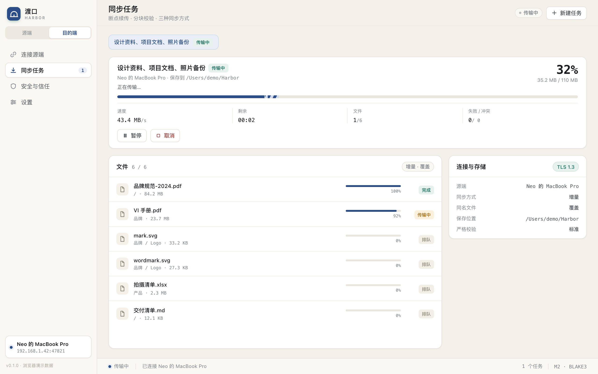
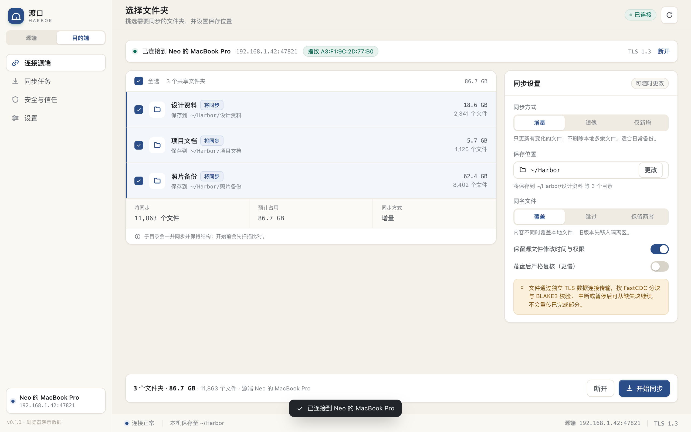
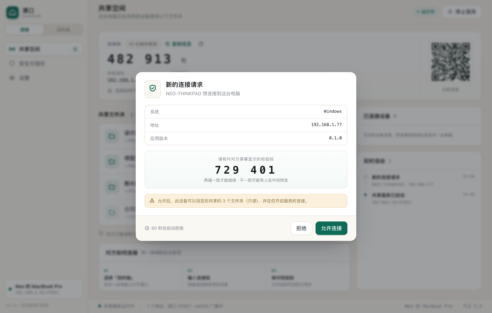

# 渡口 Harbor · 局域网点对点文件同步

> **状态：M2 文件传输已完成。** 两台电脑可以互相发现、用 6 位码配对、双端核对校验码，
> 浏览共享目录，并按 FastCDC + BLAKE3 分块传输、断点续传、原子落盘。
> 技术栈：Tauri 2 + Rust 核心 + React / TypeScript。目标平台：Windows / macOS / Linux。



## M2 能做什么

| 流程 | 已实现 |
| --- | --- |
| 创建任务 | 选择整个共享文件夹、保存位置、增量 / 镜像 / 仅新增、覆盖 / 跳过 / 保留两者、严格复核 |
| 源端清单 | 分页拉取（每页 1000）、空目录保留、`.git` / `node_modules` / 系统垃圾文件默认排除、单次最多 50 万文件 |
| 分块传输 | FastCDC 64 KiB / 1 MiB / 4 MiB，BLAKE3 块校验；独立 TLS 数据连接，一次性票据，默认 3 路并行 |
| 断点续传 | `.part` 随机写 + 已校验块位图 + 状态 JSON；暂停 / 断网 / 重启后只补缺失块 |
| 原子落盘 | 同卷 `.harbor/parts` 临时文件 → `fsync` → 设置 mtime / 权限 → `rename` 替换 |
| 冲突与镜像 | 大小 + mtime 快速比对，内容哈希二次比对；覆盖时旧文件移入 `.harbor-trash`；镜像删除可恢复 |
| 磁盘与并发 | 开始前预检可用空间；单会话最多 4 条数据连接；进度事件 240 ms 节流 |
| 任务与报告 | 任务持久化、暂停 / 继续 / 取消 / 重试失败项、速度 / ETA / 跳过重传 / 隔离区报告 |
| 界面 | 任务总览、分段进度、文件级状态、失败项、连接与存储信息、完成后打开文件夹 |

## M1 能做什么

| 流程 | 已实现 |
| --- | --- |
| 源端共享 | 系统目录选择器添加文件夹、共享开关、移除、嵌套/重复校验；目录扫描后展示文件数与体积 |
| 开启服务 | 监听 `0.0.0.0:47821`（冲突自动换端口）、mDNS 广播、一次性 6 位连接码、二维码、IP、证书指纹 |
| 新设备审批 | 源端弹窗展示设备名 / 系统 / 地址 / 6 位 SAS；允许或拒绝；60 秒超时；错误 5 次锁定 |
| 目的端发现 | mDNS 自动发现，2 秒刷新；也可手动输入 IP + 端口 + 连接码 |
| 配对等待 | 双端显示相同 SAS；源端确认后自动进入下一步；可取消连接 |
| 远端浏览 | 共享清单、目录进出、文件大小；服务端拒绝 `..`、绝对路径、符号链接逃逸 |
| 选择文件夹 | 勾选远端文件夹、设置本地保存位置；M2 起会按任务实际写入 |
| 安全与设置 | 指纹查看/复制、连接码轮换、设备名称修改、运行信息 |

**尚未实现（按里程碑）**：SPAKE2、设备密钥信任、持久化审计（M3）；
托盘、通知、自动更新与三端安装包签名（M4）。

## 界面





## 快速开始

环境：Rust 1.85+、Node.js 20+、pnpm 10。macOS 需要 Xcode Command Line Tools；Linux 需要 Tauri 的 WebKitGTK 依赖。

```bash
# 1. 安装依赖（包含 Tauri CLI）
pnpm install

# 2. 原生开发模式（自动启动 Vite + 原生窗口）
pnpm app:dev

# 3. 只预览 UI（浏览器演示数据，不需要 Tauri）
pnpm --dir apps/desktop dev   # http://127.0.0.1:1420

# 4. 核心测试（TLS、配对、浏览、分块、传输、断点、三种模式）
cargo test -p harbor-core

# 5. 构建当前平台的安装包
pnpm app:build
```

数据目录默认 `~/Library/Application Support/Harbor`（macOS）、`%APPDATA%\Harbor`（Windows）、
`~/.local/share/Harbor`（Linux）；可用 `HARBOR_DATA_DIR=/path` 覆盖。

## 实现结构

```
crates/harbor-core/   Rust 核心（可独立测试）
  engine.rs           配置、服务生命周期、审批、会话、清单、数据票据
  server.rs           TLS 监听、握手、审批、控制循环、数据连接入口
  client.rs           目的端 TLS 客户端、等待确认
  protocol.rs         u32 长度帧 + JSON 控制消息
  chunker.rs          FastCDC 流式分块 + BLAKE3 内容哈希
  sync.rs             清单 / 任务模型、位图断点、路径清洗
  tasks.rs            任务持久化、状态机、进度事件、Tauri 命令后端
  receive.rs          接收引擎：比对、落盘、续传、冲突、镜像、隔离区
  data.rs             数据连接协议：票据握手、块清单、二进制分块帧
  identity.rs         设备 id + 自签证书 + SHA-256 指纹
  pairing.rs          6 位码、常量时间比较、失败锁定
  shares.rs           扫描、列目录、清单快照、路径安全
  discovery.rs        mDNS 广播 / 浏览
  config.rs           JSON 配置（SQLite 迁移延后到 M3）

src-tauri/            Tauri 壳、IPC 命令、事件转发（harbor://event）
apps/desktop/         React + Vite UI；api.ts 在浏览器下自动切换演示后端
.github/workflows/    CI 与多平台签名发布
docs/                 功能设计、UI 规格、技术方案、M1/M2 实现、发布签名
mockup/               早期可交互设计稿（9 屏静态原型）
scripts/              版本同步、截图辅助脚本
```

**通信流程**：

```text
控制连接（TLS 1.3，单帧 2 MiB JSON）
  hello → auth{code} → auth_pending{sas} → 源端审批 → auth_ok{session}
  → list_shares / browse / manifest（游标分页）
  → data_ticket（30 秒、绑定 IP、一次性）

数据连接（同端口 TLS，二进制帧）
  data_hello{token} → data_ready
  → file_open{share,path} → file_header{size,mtime,hash,chunk_count}
  → chunk_meta{start,count}（每页 4096 块）
  → chunk_request{indices} → chunk 帧… → chunks_done
  → file_close
```

每个文件先写 `.harbor/parts/<task>/<key>.part`，块校验通过后写入对应偏移；
文件完成时重新核对内容哈希，`fsync`、设置 mtime/权限，再原子 `rename`。

## 设计交付物

| 文件 | 内容 |
| --- | --- |
| [`docs/01-product-design.md`](docs/01-product-design.md) | 产品定位、角色、功能清单、流程、同步语义、安全威胁模型、版本规划 |
| [`docs/02-ui-design.md`](docs/02-ui-design.md) | 设计语言、窗口栅格、9 屏逐屏规格、组件、文案、快捷键 |
| [`docs/03-technical-design.md`](docs/03-technical-design.md) | 目标架构、协议、同步引擎、安全与断点续传实现、数据模型 |
| [`docs/04-implementation.md`](docs/04-implementation.md) | **M1 实现说明**：已完成 / 未完成、运行、协议、安全边界、已知问题 |
| [`docs/05-release-signing.md`](docs/05-release-signing.md) | **发布与签名**：固定证书 / GPG 身份、Secrets 配置、跨版本一致性校验、轮换与验证 |
| [`docs/06-m2-implementation.md`](docs/06-m2-implementation.md) | **M2 实现说明**：数据连接、分块、断点、冲突、镜像、任务模型与测试 |
| [`mockup/index.html`](mockup/index.html) | 可交互高保真设计稿（浏览器直接打开，不依赖 Tauri） |
| [`.github/workflows/release.yml`](.github/workflows/release.yml) | 三平台并行构建、签名、GPG 汇总、创建 Release |

## 安全边界（M1 / M2）

- TLS 1.3（rustls / ring），自签证书 + SHA-256 指纹；发现记录带指纹前缀并在连接时比对。
- 6 位连接码：10 分钟有效、单次使用、成功后自动轮换、5 次失败锁定。
- 双端 SAS 人工核对；源端必须显式允许；连接码错误不泄露共享清单。
- 服务端只读；`browse` 只接受 `share_id + 相对路径`，canonicalize 后强制留在共享根内；符号链接目录拒绝。

**M2 安全边界**：数据连接需要控制连接签发的 30 秒一次性票据，并绑定对端 IP；每会话最多 4 条数据连接。
文件块逐块 BLAKE3 校验，落盘后核对文件内容哈希；目标路径逐级拒绝符号链接，相对路径清理后强制留在目标共享根内。
镜像删除与覆盖替换的旧文件都进入 `.harbor-trash`。

**仍未做**：SPAKE2（连接码仍走 TLS，MITM 防护依赖 SAS 人工核对）、设备密钥信任库、持久化审计。
完整边界见 [M1 实现说明 §6](docs/04-implementation.md#6-m1-安全边界) 与
[M2 实现说明](docs/06-m2-implementation.md)。

## 发布与签名

[`.github/workflows/release.yml`](.github/workflows/release.yml) 在 tag `v*.*.*` 或手动触发时并行构建：

- macOS universal `.dmg`：Developer ID 签名 + Apple 公证
- Windows `.msi` / NSIS `.exe`：Authenticode 签名 + RFC 3161 时间戳
- Linux `.deb` / `.rpm` / `.AppImage`：GPG 签名，并生成 `SHA256SUMS` / `SHA256SUMS.asc`

**跨版本同一签名**：CI 只从 GitHub Secrets 导入证书与私钥，绝不在构建时生成新证书；并强制比对
`APPLE_SIGNING_IDENTITY`、`WINDOWS_CERT_THUMBPRINT`、`LINUX_GPG_FINGERPRINT` 与仓库变量一致，
不一致就在产出 Release 前失败。Bundle ID 固定为 `app.harbor.desktop`，版本号由 `scripts/set-version.mjs` 单独更新。

没有证书时：

- 只想验证编译：手动运行 [`.github/workflows/build-unsigned.yml`](.github/workflows/build-unsigned.yml)，产物只进 Artifacts；
- 需要直接发一个内部测试 Release：使用 [`.github/workflows/release-unsigned.yml`](.github/workflows/release-unsigned.yml)，
  它会创建 `unsigned-vX` Release、上传三端安装包和 `SHA256SUMS`，不读取任何签名 Secrets。

两者产物都未使用发布证书签名、未公证，不能外部分发；unsigned Release 标记为 `(Unsigned)`、Pre-release，且不会覆盖 Latest。

完整的一次性配置、Secrets 清单、证书轮换与验证命令见
[`docs/05-release-signing.md`](docs/05-release-signing.md)。

## 已确认的产品决策

1. 产品名：**渡口 Harbor**。
2. 技术栈：**Tauri 2 + Rust 核心 + React**。
3. 单角色：同一时间只运行源端或目的端。
4. 仅局域网：v1 不做跨公网中继。
5. 源端只读：目的端不能修改或删除源文件。

## 下一步（M3）

1. SPAKE2 连接码、Ed25519 设备密钥与信任库，已信任设备免配对。
2. 持久化审计日志；任务与审计迁移 SQLite（WAL）。
3. `notify` 增量监听与清单失效、超大目录后台扫描。
4. 传输限速、定时任务、符号链接与更细的过滤规则。

## 开发状态

- [x] 功能设计、UI 设计、技术方案
- [x] M1 核心：TLS、配对审批、mDNS、共享目录、浏览
- [x] M1 桌面 UI：源端 / 目的端 / 安全 / 设置
- [x] 27 个核心单元测试 + 2 个双端端到端测试（配对/浏览、传输/续传/三种模式）
- [x] Tauri 桌面二进制编译通过
- [x] GitHub Actions 多平台签名发布模板（macOS / Windows / Linux）
- [x] M2 同步引擎：清单、FastCDC、并行数据连接、断点续传、三种模式、任务 UI
- [ ] M3 安全加固（SPAKE2 / 设备密钥 / 审计 / SQLite）
- [ ] M4 托盘、通知、安装包打磨与发布流程演练
