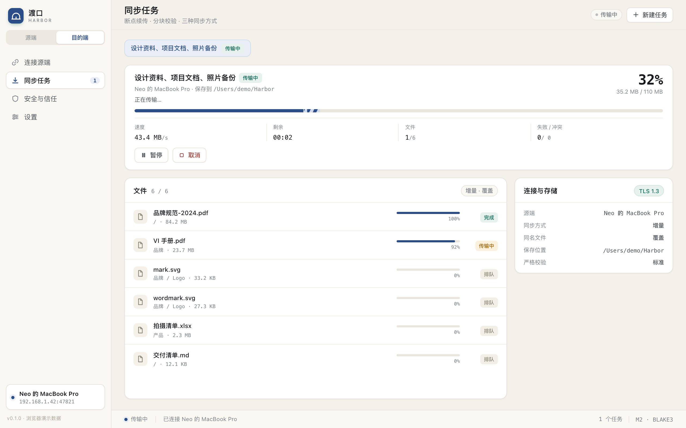

# M2 实现说明：文件传输与同步引擎

> 对应里程碑：M2「同步核心」。在 M1 的发现、配对、审批、共享浏览之上，
> 增加文件清单、内容分块、并行传输、断点续传、三种同步方式与任务 UI。
> 代码位于 `crates/harbor-core` 的 `chunker` / `sync` / `tasks` / `receive` / `data` 模块。



## 1. 能力清单

| 能力 | 实现 |
| --- | --- |
| 文件清单 | 源端扫描共享根，相对路径排序后按游标分页（每页 1000）；目录保留，空目录会创建 |
| 内容分块 | FastCDC 齿轮哈希，64 KiB / 1 MiB / 4 MiB 的最小/平均/最大值；跨平台同一份内容分块一致 |
| 哈希 | BLAKE3 块哈希；文件内容哈希 = BLAKE3(按顺序拼接的块哈希) |
| 数据连接 | 独立 TLS 连接 + 一次性票据；票据 30 秒有效、绑定对端 IP、单次使用；每会话最多 4 条 |
| 并行 | 默认 3 个工作连接（`HARBOR_TRANSFER_WORKERS` 可在 1–4 之间覆盖），每个连接串行处理文件 |
| 断点 | `.part` 随机写；每批 32 块保存位图；崩溃最多回退一批，重传的块幂等覆盖 |
| 落盘 | 同卷 `.harbor/parts/` → `fsync` → 设置 mtime/权限 → 原子 `rename` |
| 比对 | 大小 + mtime 快速跳过 → 内容哈希二次比对 → 冲突策略 |
| 同步方式 | 增量 `delta`、镜像 `mirror`、仅新增 `new_only` |
| 冲突 | 覆盖 `overwrite`、跳过 `skip`、保留两者 `keep_both` |
| 隔离区 | `<目标共享目录>/.harbor-trash/<时间戳>/...`；覆盖替换与镜像删除都会先移入 |
| 磁盘预检 | 开始时检查目标卷可用空间（预计字节 + 512 MiB 余量） |
| 任务 | 原子 JSON 持久化；暂停 / 继续 / 取消 / 重试失败项；应用重启后运行中任务变为「已中断」 |
| 事件 | `task_updated` / `task_progress`（240 ms 节流）/ `task_finished` / `task_removed` |
| 界面 | 任务总览、分段进度、速度/ETA、文件级状态、失败项、报告、打开保存位置 |

## 2. 协议

### 2.1 控制连接（继续使用 M1 的 JSON 帧）

控制连接仍是 `u32 BE 长度 + JSON`，单帧上限 2 MiB。M2 新增：

| 消息 | 方向 | 说明 |
| --- | --- | --- |
| `manifest { share_id, cursor }` | C→S | 拉取清单；`cursor` 为空表示第一页 |
| `manifest_page { page }` | S→C | `entries[]`、`next`、`total_files`、`total_bytes` |
| `data_ticket` | C→S | 申请数据连接票据 |
| `data_ticket { token, expires_in }` | S→C | 30 秒一次性票据 |

**清单快照**：第一页每次都会重新扫描，服务端生成随机快照号并缓存 5 分钟；
`next` 游标编码为 `<快照号>:<偏移>`，后续页读取同一快照，避免一次任务中清单漂移。
快照超过 5 分钟或服务重启后，客户端会收到「清单快照已过期」并重新开始。

### 2.2 数据连接

数据连接复用同一 TLS 端口，首次消息为 `data_hello { token }`；服务端校验票据后回 `data_ready`，
随后进入二进制帧：

```text
+--------+--------+-------------------------------------------+
| len:u32| kind:u8| payload                                   |
+--------+--------+-------------------------------------------+
kind=0  JSON 控制消息
kind=1  [chunk_index:u32][data]         // 单块 ≤ 4 MiB
```

| 消息 | 说明 |
| --- | --- |
| `file_open { share_id, path }` | 源端打开文件并流式分块 |
| `file_header { size, mtime_ms, mode, content_hash, chunk_count, stable }` | 文件头；`stable=false` 表示分块期间文件变化 |
| `chunk_meta { start, count }` → `chunk_meta { chunks[] }` | 块清单分页，每页最多 4096 条；客户端先拉完整清单 |
| `chunk_request { indices[] }` | 单次最多 128 块；源端按请求顺序发送 `chunk` 帧，最后发 `chunks_done { count }` |
| `file_close` → `closed` | 关闭当前文件；同一连接可继续打开下一个文件 |
| `error { code, message }` | 路径、读取、协议错误 |

数据连接不绑定具体任务，只绑定控制会话与对端 IP；源端对每个 `file_open` 重新做
`share_id + 相对路径` 的 canonicalize 校验，并拒绝符号链接文件。

> 协议号仍为 1：M2 只在需要传输时使用新增消息，M1 目的端仍可连接 M2 源端浏览；
> M2 目的端连接 M1 源端时会在拉取清单阶段失败。升级两端后再开始同步。

### 2.3 票据生命周期

1. 目的端在控制连接上发送 `data_ticket`。
2. 源端生成 32 字节随机十六进制票据，写入内存表，30 秒过期、绑定控制连接的 peer IP。
3. 目的端用同一地址建立第二条 TLS 连接，发送 `data_hello { token }`。
4. 源端 `remove` 票据（单次使用），校验 IP 与过期时间，再校验每会话数据连接数 ≤ 4。
5. 控制连接断开或停止服务时，取消该会话的所有数据连接。

## 3. 分块与校验

```text
min=64 KiB  avg=1 MiB  max=4 MiB
gear hash: h = (h << 1) + GEAR[byte]
min 之后：len < avg 用 21 位掩码，len ≥ avg 用 19 位掩码；len 达 4 MiB 强制切块
chunk_hash = BLAKE3(chunk)
content_hash = BLAKE3(chunk_hash_0 || chunk_hash_1 || ...)
```

- 齿轮表使用固定种子的 SplitMix64 生成，三端一致，不依赖 CPU 指令集。
- 空文件没有块，内容哈希为 BLAKE3 空输入。
- 源端 `file_header` 返回完整块清单后，客户端会重新计算 `content_hash` 校验一致性。
- 接收端逐块校验，连续 3 次失败的块会使该文件失败（不会写入错误数据）。

## 4. 接收流程

### 4.1 任务创建与扫描

1. 目的端选择共享文件夹、保存位置、同步方式、冲突策略、是否严格复核。
2. 任务记录写入 `<data_dir>/tasks/<task_id>.json`，状态 `pending`。
3. 开始后按共享目录逐个拉取清单：
   - 逐级创建目标目录，拒绝符号链接与同名文件占位；
   - 文件路径按目标平台清洗（Windows 非法字符、保留名、尾随空格/点）；
   - 大小写不敏感碰撞时追加 ` (2)`；
   - 已存在且 `size + mtime` 一致的文件标记 `skipped`；
   - `new_only` 下已存在的文件一律跳过；
   - 目标路径是目录或符号链接时标记 `failed`。
4. 扫描完成后状态 `running`，启动最多 3 个工作连接处理文件队列。

### 4.2 单文件

```text
open_file
  → 目标已存在？
      快路径（size + mtime）→ skipped
      同大小 → 计算本地内容哈希 → 相同则更新 mtime 并 skipped
      不同 → overwrite / skip / keep_both
  → 加载 .part 状态；源端文件哈希变化则丢弃旧断点
  → 按缺失位图分批请求块
      校验块哈希 → seek(offset) → write_all → 位图置位
      每批保存状态 JSON，节流推送进度
  → 全部到齐：flush + fsync
  → 严格复核（可选）：重新分块 .part，比对内容哈希
  → 设置 mtime / 权限
  → 覆盖模式：旧目标移入 .harbor-trash
  → rename(.part → target)
  → 删除状态文件，标记 done
```

### 4.3 断点状态

```text
<目标共享目录>/.harbor/parts/<task_id>/
├─ <key>.part      # set_len 预分配，随机写
└─ <key>.json      # size / mtime / content_hash / chunk_lens / received 位图
```

`key` 是 `BLAKE3(share_id || 0x00 || 相对路径)` 的前 16 字节十六进制。位图为每块 1 bit，
1 万块约 1.25 KiB。状态每批块写入一次；崩溃最多丢失一批（32 块）的进度，重传块会覆盖同一偏移。

恢复时校验：

1. `.part` 存在且长度等于源文件大小；
2. 状态里的 `content_hash`、块长度列表与当前源端文件头一致；
3. 对位图标记为已完成的块重新读盘计算 BLAKE3；失败块清除标记并重新传输；
4. 任一校验不符就删除 `.part` 与状态，从零开始；否则只请求缺失块。

任务记录只保存汇总、失败项与报告，不保存全量文件列表；重启后重新扫描清单，
已完成的文件会被快速跳过，未完成的 `.part` 继续。因此任务记录很小，50 万文件也不会产生巨型 JSON。

### 4.4 同步语义

| 方式 | 新增 | 源端修改 | 源端删除 | 本地多余 |
| --- | --- | --- | --- | --- |
| 增量 `delta` | 传输 | 按冲突策略 | 保留 | 保留 |
| 镜像 `mirror` | 传输 | 按冲突策略 | 移入隔离区 | 移入隔离区 |
| 仅新增 `new_only` | 传输 | 跳过 | 保留 | 保留 |

- 镜像清理只在**没有失败项**时执行，避免「传输失败 + 删除旧文件」双重损失。
- 镜像只处理该任务的目标共享子目录（`<保存位置>/<共享名>/`），并跳过 `.harbor`、`.harbor-trash`。
- 源端空目录会被创建；镜像会删除目标中源端已不存在的空目录。
- 覆盖替换与镜像删除的旧文件写入 `.harbor-trash/<Unix 秒>/<相对路径>`，UI 报告隔离区项数。

### 4.5 冲突策略

| 策略 | 行为 |
| --- | --- |
| `overwrite` | 传输后用 `.part` 替换目标；旧文件先移入隔离区 |
| `skip` | 不传输，保留本地文件，文件状态标记 `conflict` |
| `keep_both` | 保留本地文件，源端版本写为 `原名 (来自 <设备> YYYY-MM-DD).ext`；重名继续追加 ` (2)` |

## 5. 任务状态机

```text
pending ──start──> scanning ──清单完成──> running ──完成──> done
   │                   │                    │
   │                   └──pause/cancel──────┤
   └──pause/cancel─────────────────────────┤
                                            ├──pause──> paused ──start──> scanning
                                            ├──cancel─> cancelled
                                            └──网络/磁盘错误──> interrupted ──start──> scanning
```

- 运行中任务在应用重启后加载为 `interrupted`，不会自动开始（避免占用带宽）。
- 继续时按设备 id 找回当前会话：重连会生成新 session id，任务记录里的旧 id 会自动替换。
- `retry` 与 `start` 共用同一套断点；已完成文件通过 mtime/哈希快速跳过。

## 6. 代码结构

| 文件 | 职责 |
| --- | --- |
| `chunker.rs` | 流式 FastCDC、块哈希、文件内容哈希、单元测试 |
| `sync.rs` | 清单 / 任务 / 文件状态模型，位图与断点结构，跨平台路径清洗 |
| `tasks.rs` | `TaskManager`：加载/保存、状态迁移、进度节流、Tauri 后端 API |
| `receive.rs` | 扫描比对、工作队列、分块落盘、续传、冲突、镜像、隔离区、报告 |
| `data.rs` | 数据连接协议、源端服务、目的端客户端 |
| `engine.rs` | 源端会话注册、数据票据、清单快照、远程会话与任务 API |
| `server.rs` | 控制连接审批后注册源端会话；识别 `data_hello` 并交给 `data::serve` |
| `client.rs` | 控制连接与数据连接共用 TLS 建连/指纹校验 |

## 7. 前端与命令

Tauri 命令：

```text
create_sync_task(request) -> TaskDetail
start_sync_task(task_id) / pause_sync_task(task_id) / cancel_sync_task(task_id)
retry_sync_task(task_id) / remove_sync_task(task_id)
list_sync_tasks() / get_sync_task(task_id)
open_folder(path)
```

事件：

```text
task_updated  { task }
task_progress { task, files[] }     // 240 ms 节流，最多 8 个文件
task_finished { task, report }
task_removed  { task_id }
transfer_served { device, path, size }  // 源端活动，最多 1 秒一次
```

任务页每秒拉取一次 `get_sync_task` 以获取完整文件列表；汇总卡与导航徽标由事件实时更新。
任务列表最多展示最近 6 个任务；文件列表最多展示 400 条（后端按失败/传输中/排队优先裁剪）。

## 8. 测试

```bash
cargo test -p harbor-core
```

- 27 个单元测试：分块边界/确定性/局部变化、位图、路径清洗、冲突改名、清单扫描、状态迁移等。
- `tests/end_to_end.rs`：真实 TCP + TLS 的配对、审批、浏览、路径穿越、停用共享。
- `tests/transfer_e2e.rs`：真实传输
  - 增量：目录、空文件、多块二进制文件、忽略规则、mtime；
  - 二次增量：跳过未变化、保留本地多余文件；
  - 仅新增：不覆盖；
  - 镜像：源端删除 + 本地多余文件进入隔离区；
  - 保留两者：本地版本 + 源端改名版本；
  - 64 MiB 大文件暂停/继续，断言 `resumed_bytes > 0` 且最终哈希一致；
  - 无效数据票据被拒绝、路径穿越被拒绝。

## 9. 已知限制与后续

| 限制 | 现状 | 计划 |
| --- | --- | --- |
| 任务持久化 | 原子 JSON，非数据库 | M3 迁移 SQLite WAL，与审计共用 |
| 配置 | `config.json` | M3 迁移 SQLite |
| 清单扫描 | 每次任务重新全量扫描，单共享最多 50 万文件 | `notify` 增量监听 + 后台扫描 |
| 目录元数据 | 保留文件 mtime/权限；目录权限不保留 | 后续补齐 |
| 隔离区清理 | 不自动删除 | 7 天后清理 / 设置页手动清空 |
| 符号链接 | 跳过 | 可选仅同步共享根内的相对链接 |
| 限速 | 未实现 | 令牌桶，发送侧 |
| 大文件 | 源端先读一遍分块，再按需读块；两遍 I/O | 边分块边缓存/流式发送 |
| Windows 长路径 / macOS NFC | 未启用 `\\?\` 前缀，也未做 NFC 归一化；路径总长上限 4096 字节 | 后续跨平台补齐 |
| 任务并发 | 同一时间可运行多个任务，但共用设备连接 | 后续做全局队列与每设备并发上限 |
| 公网 / 移动端 | 不做 | v1 仅局域网 |

## 10. 关键安全边界

- 数据连接必须持有控制会话签发的一次性票据；票据绑定 IP、30 秒过期、用后即删。
- 源端每次 `file_open` 重新校验共享 id、相对路径 canonical 前缀与符号链接。
- 目标端逐级拒绝符号链接；所有写入路径必须位于目标共享根内。
- 块级 BLAKE3 校验失败不写入；连续 3 次失败使文件失败。
- 控制连接断开即取消该会话全部数据连接。
- 连接码 / SPAKE2 / 设备密钥仍在 M3；M2 的传输安全依赖 M1 的 TLS + SAS 人工核对。
