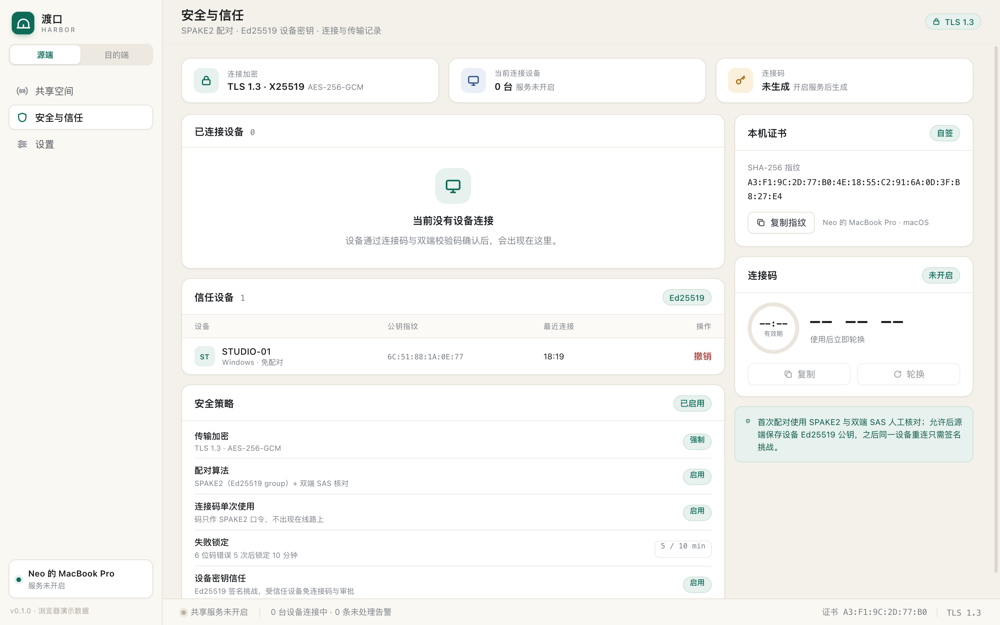

# M3 实现说明：SPAKE2、设备密钥与审计

> 对应里程碑：M3「安全与恢复」的第一阶段。在 M2 的 TLS 数据连接与文件同步之上，
> 把首次配对从「连接码明文走 TLS」升级为 SPAKE2，并加入 Ed25519 设备密钥、
> 信任设备免配对与持久化审计。协议版本从 1 升到 2。



## 1. 本阶段完成

| 能力 | 实现 |
| --- | --- |
| SPAKE2 配对 | `spake2` 0.4（Ed25519 group）；6 位连接码只作为口令，协议消息中不出现 |
| 配对确认 | 双端从 SPAKE2 密钥与固定顺序 transcript 派生 client/server 确认值 |
| SAS | 双端从同一材料派生 6 位数字，人工核对后才允许连接 |
| 设备密钥 | Ed25519 长期密钥，独立于 TLS 私钥；0600 持久化；公钥随 `hello` 交换 |
| 信任设备 | 首次配对经源端允许后写入信任库；重连走签名挑战，免连接码、免审批 |
| 双向验证 | 源端签名挑战用 Ed25519；目的端签名用 Ed25519；两者都绑定 TLS exporter |
| TLS 绑定 | 签名包含 `export_keying_material`，不能跨连接重放，也不能由终止 TLS 的中间人转发 |
| 回退 | 本机撤销信任后仍可用连接码重新配对；源端对已信任设备也接受 `pair_begin` 回退 |
| 审计 | JSONL 追加式持久化：连接请求、允许/拒绝、信任重连、认证失败、连接/断开、任务结果 |
| 安全页 | 信任设备表、公钥指纹、撤销、最近事件、SPAKE2/Ed25519 状态 |

## 2. 协议流程

### 2.1 首次配对（源端未信任该设备）

```text
目的端                                              源端
  │ hello {device, pubkey}                          │
  ├────────────────────────────────────────────────>│
  │<──────── hello {device, pubkey, trusted=false} ─┤
  │                                                 │ 取当前连接码作 SPAKE2 口令
  │ pair_begin {message_A}                          │
  ├────────────────────────────────────────────────>│
  │<──────── pair_challenge {message_B} ────────────┤
  │ 计算 K、确认值、SAS                              │ 计算 K、确认值、SAS
  │ pair_finish {confirm_client}                    │
  ├────────────────────────────────────────────────>│
  │                                                 │ 校验 confirm_client
  │<──── pair_finish_ack {confirm_server, sas} ─────┤
  │ 校验 confirm_server / SAS                        │ 生成待审批请求
  │                                                 │ UI 显示 SAS，用户允许
  │<────────────── auth_ok {session} ───────────────┤
  │                                                 │ 写入设备公钥到信任库
```

- 连接码使用 `PairingCode` 的 10 分钟有效期与 5 次失败锁定；SPAKE2 确认失败累加尝试次数。
- 配对成功后连接码立即消费并轮换；即使源端随后拒绝审批，码也不再可用。
- 源端只在用户允许后写入信任库；拒绝不会写入。

### 2.2 已信任设备重连

```text
目的端                                              源端
  │ hello {device, pubkey}                          │
  ├────────────────────────────────────────────────>│
  │<──── hello {device, pubkey, trusted=true} ──────┤
  │<── auth_challenge {challenge, server_sig} ──────┤  源端签名 TLS exporter
  │ 验证 server_sig（本机信任库中的源端公钥）        │
  │ auth_response {client_sig}                      │
  ├────────────────────────────────────────────────>│  验证 client_sig
  │<────────────── auth_ok {session} ───────────────┤
```

- 挑战是 32 字节随机值；源端与目的端分别计算当前 TLS 连接的 exporter：
  - label `harbor-auth-v1`
  - context = `client_device_id || 0x00 || server_device_id`
- 源端签名消息前缀 `harbor-server-auth-v1`，目的端签名前缀 `harbor-auth-v1`，均拼接 challenge、双方设备 id 与 exporter。
- 目的端只有在**本机信任库**中存在源端 id、未撤销且公钥与 `hello.pubkey` 一致时才走信任路径；否则要求连接码。
- 源端对已信任设备也接受 `pair_begin`，因此本机撤销信任后仍可用连接码回退重新配对。

### 2.3 连接码与失败锁定

- 连接码不再出现在 `auth {code}` 中；它是 SPAKE2 的 password。
- 服务端 `pairing_secret()` 在过期、已用或尝试次数达到 5 次后返回 `None`。
- 每次 SPAKE2 确认失败调用 `record_pair_failure()`；成功调用 `consume_pairing()` 并立即轮换。
- 已信任设备的签名挑战失败不消耗连接码，但审计记录为 `auth_failed`；需要重新用码配对。

## 3. 密钥与信任库

### 3.1 身份文件

```text
<data_dir>/identity/
├─ device_id          # UUID
├─ tls_cert.der       # 自签 TLS 证书
├─ tls_key.der        # TLS 私钥
└─ device_key         # Ed25519 32 字节种子，0600
```

- 公钥 = `ed25519_dalek::SigningKey::from_bytes(seed).verifying_key()`。
- 公钥指纹 = SHA-256(公钥)，展示为冒号分隔大写十六进制。
- 设备 id / TLS 证书 / Ed25519 密钥都会在重启后保持不变。

### 3.2 信任库

```text
<data_dir>/trusted_devices.json
```

```json
[{
  "id": "uuid",
  "name": "设备名",
  "os": "macOS",
  "pubkey": "hex(32B)",
  "fingerprint": "AA:BB:...",
  "trusted_at": 1794136613303,
  "last_seen": 1794136613303,
  "revoked": false
}]
```

- 原子写：临时文件 + `rename`，Unix 0600。
- 源端在首次配对**允许**后写入目的端；目的端在首次配对成功后写入源端。
- `is_trusted(id, pubkey)` 要求 id 匹配、公钥匹配、未撤销。
- 撤销只置 `revoked=true`，保留历史；UI 需要输入设备名称确认。
- 信任库不含私钥、连接码或文件信息。

## 4. 审计

```text
<data_dir>/audit.jsonl
```

字段：

```json
{"id":1,"at":1794136613303,"kind":"trusted_login","level":"ok",
 "device_id":"...","device_name":"...","address":"192.168.1.31:47821",
 "detail":"已信任设备签名挑战通过"}
```

| kind | 说明 | level |
| --- | --- | --- |
| `connection_request` | 首次配对等待审批 | warn |
| `approved` / `denied` | 源端允许 / 拒绝 | ok / warn |
| `trusted_login` | 已信任设备签名通过 | ok |
| `auth_failed` | SPAKE2 或签名失败 | warn |
| `connected` / `disconnected` | 源端控制会话 | ok / info |
| `connected_out` / `connect_failed` | 目的端连接结果 | ok / warn |
| `task_finished` | 同步完成（含失败数） | ok / warn |
| `task_paused` / `task_cancelled` / `task_interrupted` | 任务暂停/取消/中断 | info / warn |

- 只记录元数据，不记录文件内容、连接码、密钥、SAS。
- 内存保留最近 2000 条；启动时加载最近 2000 条。
- 当前不自动轮转/删除，也不支持 CSV 导出（后续 M3 收尾）。

## 5. 代码与 UI

| 文件 | 职责 |
| --- | --- |
| `identity.rs` | TLS 身份 + Ed25519 密钥、签名/验签 |
| `pairing.rs` | 连接码状态、SPAKE2、确认值、SAS、挑战消息 |
| `trust.rs` | 信任设备 JSON 库、公钥匹配、撤销 |
| `audit.rs` | JSONL 审计追加与加载 |
| `server.rs` | 首次配对 / 信任挑战 / 回退 / 审批 / 审计 |
| `client.rs` | SPAKE2 客户端、源端签名验证、TLS exporter、双向信任写入 |
| `engine.rs` | 身份、信任库、审计、连接码生命周期 |

Tauri 命令：

```text
list_trusted_devices() -> TrustedDevice[]
revoke_trusted_device(device_id)
list_audit_events(limit?) -> AuditEvent[]
```

安全页：

- 信任设备表：设备名、系统、公钥指纹、最近连接、撤销。
- 最近事件优先展示持久化审计；没有审计时回退到本次运行的 UI 活动。
- 安全策略卡片显示 SPAKE2、Ed25519、失败锁定与设备密钥信任状态。

## 6. 测试

```text
cargo test -p harbor-core
  33 个单元测试
  1 个 M1 端到端：配对、审批、浏览、拒绝、错码、停用共享
  1 个 M2 端到端：传输、断点、三种模式
```

M3 新增覆盖：

- SPAKE2 双端一致：相同连接码派生相同确认值与 SAS。
- 错误连接码：确认值不一致。
- 挑战消息域分隔（client/server id、exporter）。
- Ed25519 签名/验签与密钥持久化。
- 信任库写入、撤销、重载。
- 端到端：首次配对写入信任 → 无码重连成功 → 本机撤销后连接码回退 → 源端撤销后回到审批/错码流程。

## 7. 已知限制与后续

| 限制 | 现状 | 后续 |
| --- | --- | --- |
| 存储 | 任务/配置/信任/审计仍是 JSON/JSONL | SQLite WAL 迁移 |
| 审计保留 | 只保留最近 2000 条内存视图，文件不轮转 | 30 天保留 + 轮转 + CSV 导出 |
| 信任设备重命名 | 未提供 | 安全页编辑 |
| 服务端撤销推送 | 只影响下次连接 | 撤销时断开当前会话 |
| 设备公钥轮换 | 需重新连接码配对 | 显式轮换流程 |
| 多用户/多账户 | 单机单用户 | v2 |
| 中继/公网 | 不做 | 后续 |
